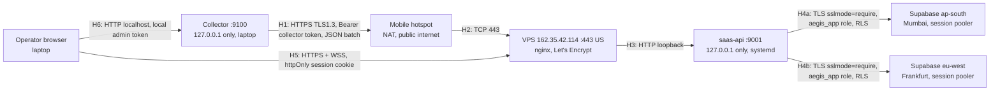
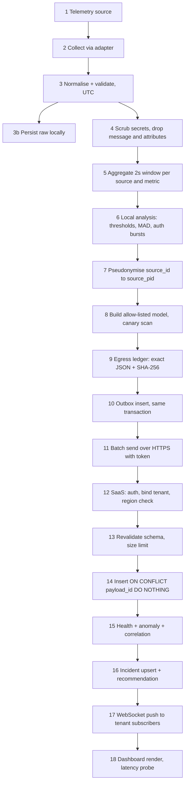
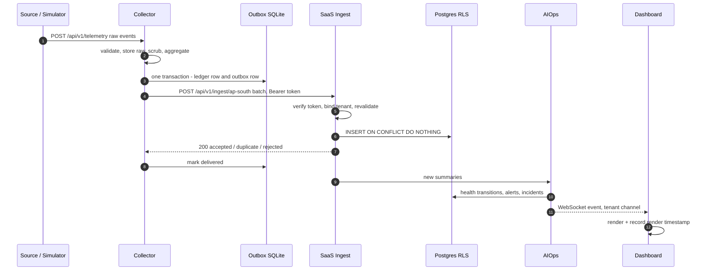
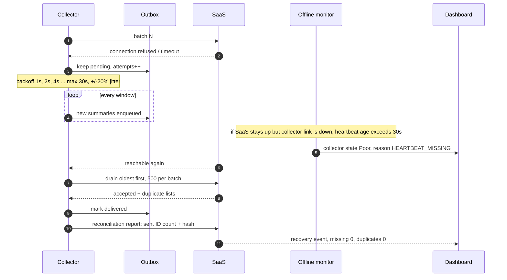

# AEGIS — Architecture

## 1. Trust boundary and components

```mermaid
flowchart LR
  subgraph T1["TIER 1 - Customer environment (team laptop)"]
    direction TB
    SIM["Dev simulator / JSONL replay<br/>(SIMULATED)"]
    AG["System agent<br/>psutil + ping probe"]
    API1["HTTP ingest<br/>POST /api/v1/telemetry"]
    subgraph COL["AEGIS Collector :9100"]
      N["Normalise + validate"]
      R["Scrub + redact"]
      A["Aggregate 2s windows"]
      D["Local detectors<br/>auth bursts, thresholds, MAD"]
      P["Policy + allow-list<br/>Pydantic extra=forbid"]
      E["Egress ledger<br/>SHA-256 per payload"]
      O["Outbox<br/>SQLite WAL"]
      S["Sender<br/>retry, backoff, jitter"]
    end
    RAW[("collector.db<br/>raw_events, pseudonym map")]
    LC["Collector console<br/>localhost only"]
  end

  subgraph T2["TIER 2 - Central SaaS (VPS, Docker Compose)"]
    direction TB
    CAD["Caddy :443<br/>TLS termination"]
    ING["Ingest API<br/>token auth, revalidate, dedup"]
    AIO["AIOps engine<br/>health, anomaly, correlation"]
    WS["WebSocket hub<br/>tenant-scoped"]
    UI["Operator API + web app"]
    PGA[("Postgres db aegis_ap_south<br/>RLS")]
    PGE[("Postgres db aegis_eu_west<br/>RLS")]
  end

  SIM --> API1
  API1 --> N
  AG --> N
  N --> R --> A --> D --> P --> E --> O --> S
  N -.raw.-> RAW
  LC -.reads.-> RAW
  LC -.reads.-> E
  S == "HTTPS + Bearer token<br/>metadata only" ==> CAD
  CAD --> ING
  ING --> PGA
  ING --> PGE
  ING --> AIO
  AIO --> WS
  WS --> UI
```

**The boundary is the arrow `S ⇒ CAD`.** It is the only path out of Tier 1 and accepts only `IngestBatch` JSON. The SaaS exposes no endpoint that accepts raw records, and no SaaS component can read `collector.db`.

## 2. Network diagram (every hop labelled)

| Hop | From → To | Protocol | Auth | Data | Measured (2026-11-20) |
|---|---|---|---|---|---|
| H1/H2 | Collector → VPS nginx | HTTPS, TLS 1.3 (LE cert) | per-collector bearer token (SHA-256 stored server-side) | allow-listed metadata batches, heartbeats | ~279 ms RTT over hotspot |
| H3 | nginx → saas-api | HTTP on loopback | none (not exposed; :9001 unreachable externally) | same | — |
| H4a/b | saas-api → Supabase (regional) | Postgres over TLS via session pooler | `aegis_app` (no BYPASSRLS), RLS per tenant | tenant-scoped rows, region-pinned | 242 ms (Mumbai) / 89 ms (Frankfurt) per round trip |
| H5 | Browser → SaaS | HTTPS + WSS | operator JWT in httpOnly Secure SameSite=Strict cookie | tenant metadata | — |
| H6 | Browser → Collector | HTTP loopback only | local admin token | raw + masked records, ledger (Privacy Glass left pane) | — |

**Deployed (Phase 4b):** `https://aegis.162-35-42-114.sslip.io`. See `docs/runbooks/VPS_DEPLOY.md`.
**Fallback topology (venue network failure):** run the SaaS on the laptop (`scripts/dev.ps1 -NoDb`, still Supabase) or fully local (Docker Postgres). Documented as a weaker trust boundary (same host).
**Known limitation (K22):** one SaaS node in the US serves both regional databases. Production regional ingest nodes would sit next to each regional DB.

## 3. Data flow

## 4. Sequence: normal operation

## 5. Sequence: SaaS outage and recovery

## 6. Component ownership

| Component | Path | Owner role |
|---|---|---|
| Contracts | `packages/contracts` | A + B |
| Collector | `apps/collector` | A |
| Simulator + scenarios | `simulator/`, `scripts/scenarios` | D |
| SaaS API, ingest, tenancy | `apps/saas-api` | B |
| AIOps engine | `apps/saas-api/aiops` | D |
| Web app | `apps/web` | C |
| Deploy (Compose, Caddy) | `infra/` | B |

## 7. Scalability story (J2)
- **Collectors:** stateless senders with local durable state. Ingest is horizontally scalable behind Caddy/LB because dedup lives in the database (unique `(tenant_id, payload_id)`).
- **Volume:** 2 s aggregation turns 100–500 raw ev/s into about one payload per source-metric per window, and batching reduces that to roughly 1 request/s per collector.
- **Tenants:** RLS plus a tenant_id-leading composite index on every table. Per-region databases shard naturally by residency.
- **Next step (production):** a message queue between ingest and AIOps, partitioned tables by time, a read replica for dashboards. Out of scope for 24 h.
