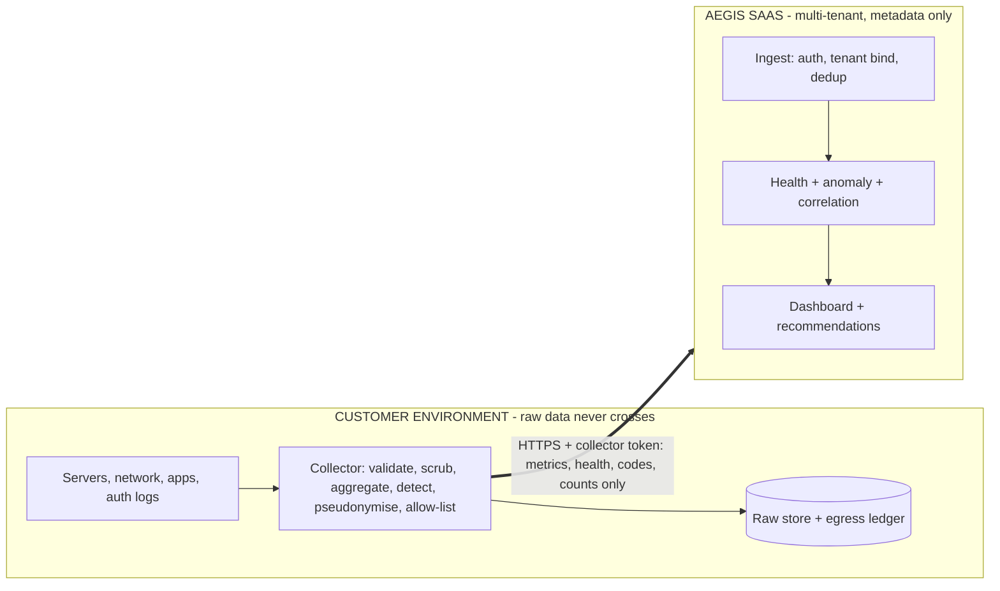

# AEGIS — Privacy-First Autonomous Intelligence & Observability
*CICADA 2026 · Judging Phase 1 one-pager*

**Problem:** Central monitoring usually means shipping raw logs, payloads and credentials off-site. That widens the attack surface and breaks compliance. Operators also drown in duplicate threshold alerts.

**Our answer:** A local collector keeps every raw record inside the customer environment and sends only **allow-listed, aggregated, pseudonymised metadata** to a multi-tenant SaaS. The SaaS turns that metadata into four-state health, correlated incidents and **explainable** recommendations. An **egress proof** shows the exact bytes of every payload that left.

| Leaves (allow-listed) | Stays local | Redacted / dropped |
|---|---|---|
| metric aggregates (min/max/mean/p95), window times (UTC) + source timezone, `source_pid` pseudonym, category, severity, health state, summary code, anomaly stats, auth-failure **counts**, collector heartbeat | raw events, log messages, usernames, IPs, hostnames, original source IDs, pseudonym key, secrets | passwords, API keys, tokens, keys (scrubbed in the local view); `message` and `attributes` never serialised outbound |

**Who sees what:** customer local admin sees raw data (local console only). A tenant's operators see only their tenant's metadata (enforced by token/session + app checks + Postgres row-level security). Platform admins see no tenant metrics.

**Use cases:** infrastructure health · network latency/packet loss · repeated failed logins · collector fleet health · privacy proof.

**MVP demo:** a fake secret in a raw log → visible on the collector, absent from the SaaS (grep-verified, hash-matched egress proof) → a CPU baseline deviation flagged with its evidence → related network alerts merged into one incident with a recommendation → SaaS outage → buffered → recovered with 0 missing / 0 duplicate IDs.

**Telemetry plan:** schema-compatible dev simulator (clearly labelled) plus a local system agent and JSONL replay. The official stream gets an adapter when it is supplied.

**Global-ready:** regional ingest endpoint, tenant pinned to a regional database, UTC + IANA timezone, event-time ordering, idempotent payload IDs.

**Team (4):** A Collector & Privacy · B SaaS & Reliability · C Dashboard & UX · D AIOps, QA & Pitch.
